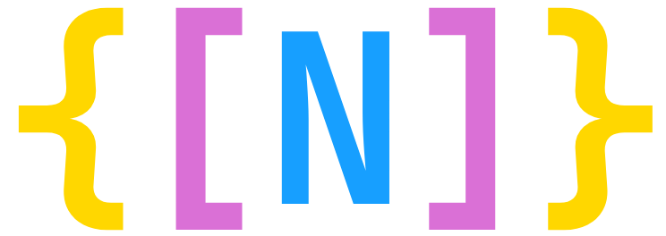
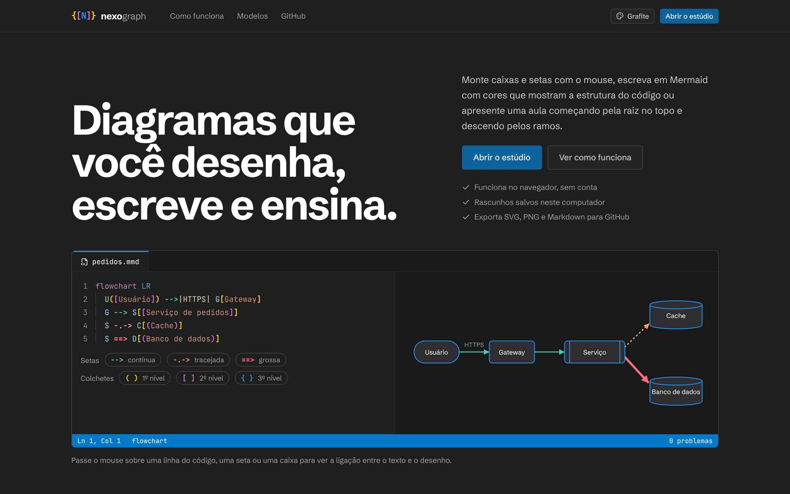
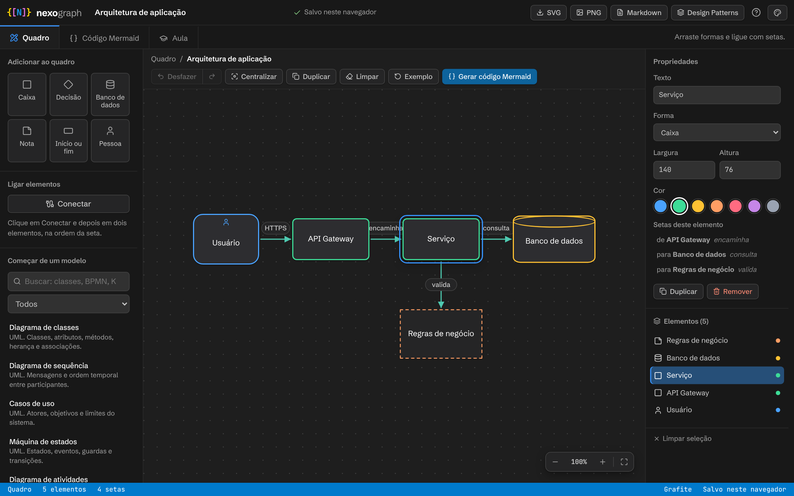
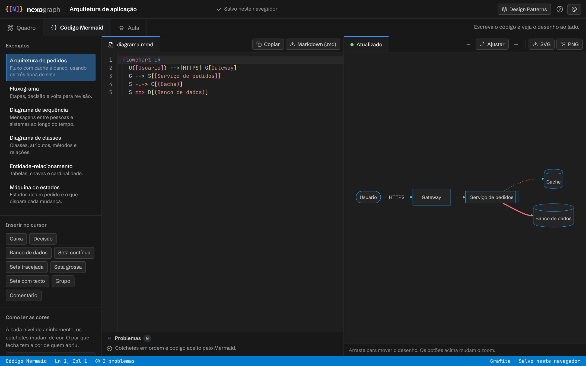
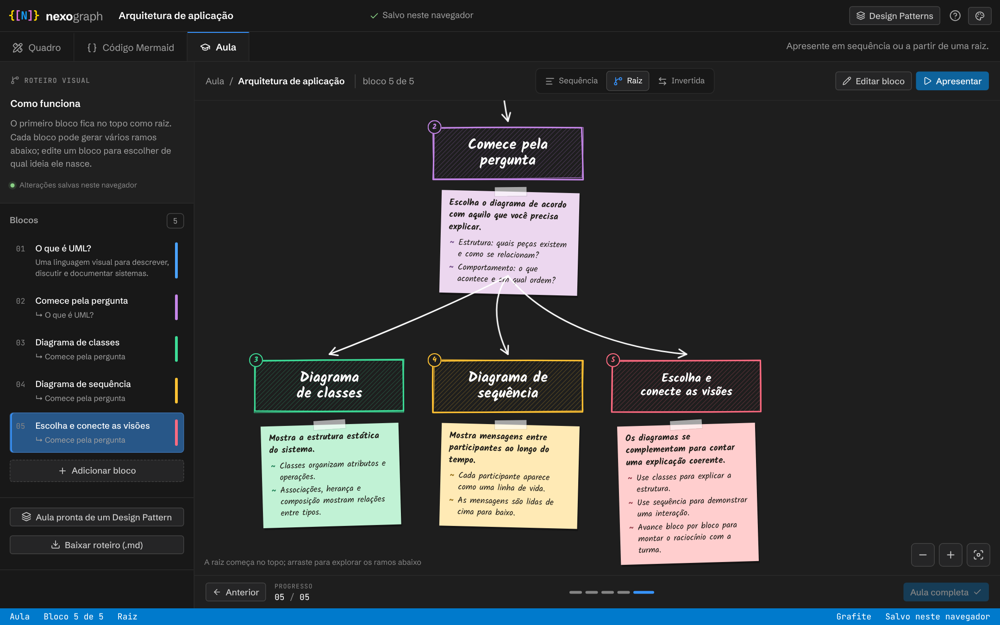

<p align="center">
  
</p>

<h1 align="center">NexoGraph<br><sub><sup><sup><sub>Copyright (©) 2026 André Felipe de Barros</sub></sup></sup></sub></h1>

<p align="center">
  Editor de diagramas que roda no navegador e junta três jeitos de criar no mesmo estúdio: desenhe no quadro arrastando caixas e ligando setas, escreva em Mermaid num editor com colchetes e setas coloridos, ou monte uma aula que revela o diagrama bloco a bloco, como um rascunho feito à mão em papel. Exporte SVG, PNG ou Markdown (<code>.md</code>) com o diagrama pronto para o GitHub.<br>
  Sem conta, sem servidor e sem instalar nada além do Node.js: tudo fica salvo no seu navegador.<br>
  Comece de um dos 63 modelos prontos (UML, BPMN, C4, ER, SysML e outros) ou de um dos 46 Design Patterns.
</p>

<p align="center">
  <strong>Versão 0.6.0</strong> · Next.js 16 (App Router) · React 19.2 · TypeScript · Mermaid 11 · CSS puro com variáveis · lucide-react · ESLint
</p>

---

> **Para quem quer só ver funcionando:** rode `npm install` e `npm run dev`, abra [http://localhost:3000](http://localhost:3000) e clique em **Abrir o estúdio**. Já existe um exemplo esperando no quadro.

> **Quer ajudar?** Contribuições são bem-vindas. Leia o [`CONTRIBUTING.md`](CONTRIBUTING.md) antes de abrir um pull request e o texto da [Licença](#licença) para saber o que pode e o que não pode ser feito com o código.

<p align="center">
  
</p>

## Novidades da versão 0.6.0

- **Quadro com zoom e navegação:** zoom de 40% a 200% pelos botões no canto da folha, por `Ctrl` + roda do mouse ou por `Ctrl` + `+` / `-` / `0`, botão **Ajustar à tela**, arraste o fundo para navegar e dê dois cliques em qualquer ponto vazio para criar uma caixa ali.
- **Refazer e selecionar tudo:** o histórico agora vai e volta (`Ctrl` + `Shift` + `Z` ou `Ctrl` + `Y`), `Ctrl` + `A` seleciona todos os elementos e mover com as setas do teclado também entra no histórico.
- **Setas mais legíveis:** o texto de cada seta ganhou uma etiqueta com fundo própria, que sobe quando o espaço entre as formas é curto, e a seta destaca ao passar o mouse.
- **Aula:** blocos podem ser movidos para cima e para baixo, a apresentação abre em tela cheia de verdade e aceita `Enter`, `Home` e `End`.
- **Salvamento mais leve:** o estado é gravado depois de uma pequena pausa, e não a cada movimento do mouse, com indicador **Salvando…** / **Salvo neste navegador** e aviso quando o navegador não deixa salvar.
- **Diálogos acessíveis:** ajuda, biblioteca de Design Patterns e a confirmação de troca de exemplo usam o mesmo componente, com foco preso dentro da janela, retorno do foco ao fechar, `Esc` e animação de entrada. A confirmação nativa do navegador deu lugar a uma janela com a opção **Copiar e trocar**.
- **Interface mais fluida:** transições suaves em botões, abas, campos e cartões, notificações animadas com ícone, menu de temas animado, cabeçalho translúcido na página inicial, estado vazio centralizado e carregamento do estúdio com indicador.
- **Correções:** o estúdio não estoura mais a largura em telas de celular, os links de seção da página inicial não ficam escondidos atrás do cabeçalho, o aviso de carregamento usa a cor certa do tema e o rodapé mostra a versão real do `package.json`.
- **Projeto:** favicon, metadados de página, `.gitignore`, `npm run check`, CI com lint, tipos e build e código sem comentários soltos.

O histórico completo está no [`CHANGELOG.md`](CHANGELOG.md).

## O que o NexoGraph faz

- **Quadro:** seis formas (caixa, decisão, banco de dados, nota, início ou fim e pessoa) em sete cores. Arraste para mover, dê dois cliques para editar o texto e use **Conectar** para ligar duas formas com uma seta, que aceita texto e pode ter o sentido invertido. Seleção múltipla com Shift ou `Ctrl` + `A`, duplicar, desfazer e refazer, setas do teclado para ajustar a posição, zoom com ajuste à tela, navegação arrastando o fundo, criação de caixa com dois cliques na folha e um botão **Centralizar** que coloca o diagrama no meio da tela.
- **Código Mermaid:** editor com cara de VS Code, escrito do zero. Cada nível de colchetes ganha uma cor (dourado, lilás e azul, em ciclo), o par do colchete sob o cursor fica destacado e cada tipo de seta tem a sua cor (contínua, tracejada, grossa e simples). Fecha colchetes e aspas sozinho, comenta linhas com `Ctrl+/`, mostra guias de recuo, número de linha e posição do cursor. Colchete que não fecha deixa a linha vermelha e aparece no painel **Problemas**, com a linha onde está o erro.
- **Do quadro para o código, só se você quiser:** o quadro funciona sozinho. Quando terminar o desenho, **Gerar código Mermaid** transforma o que está na tela em um `flowchart` escrito. O inverso também vale: dá para ignorar o quadro e escrever direto na aba de código, com seis exemplos e botões para inserir caixa, decisão, banco de dados e cada tipo de seta no cursor. A visualização ao lado atualiza enquanto você digita e tem zoom e ajuste à tela.
- **Aula:** cada bloco vira uma caixa desenhada à mão, com contorno torto, hachura, um post-it com a explicação e uma seta curva que se desenha sozinha a partir do bloco anterior. Há três organizações: **Sequência** (da esquerda para a direita), **Raiz** (a ideia principal no topo e os ramos para baixo, com a escolha de qual bloco gera cada ideia) e **Invertida** (da direita para a esquerda). Os blocos podem ser reordenados, e a folha acompanha o bloco atual e pode ser arrastada e ampliada.
- **Apresentação em tela cheia:** usa a tela cheia do navegador, navega por setas do teclado, espaço, `Enter`, `PageUp` / `PageDown`, `Home` e `End`, mostra a barra de progresso e sai com `Esc`.
- **Modelos e Design Patterns:** 63 modelos de diagrama em 11 famílias (UML, Arquitetura, Processos, Infraestrutura, Dados, Análise, UX e produto, SysML, Gestão, Testes e Segurança), com busca e filtro. A biblioteca de **Design Patterns** traz os 23 padrões GoF e padrões de arquitetura, persistência e sistemas distribuídos (46 ao todo), que abrem como diagrama editável ou como uma aula pronta.
- **Exportação:** SVG e PNG do quadro, SVG e PNG do diagrama Mermaid, copiar o código, arquivo `.md` com um bloco `mermaid` que o GitHub renderiza sozinho e roteiro da aula em Markdown, que preserva a organização escolhida.
- **Cinco temas:** Grafite (padrão, escuro no estilo VS Code), Tokyo Night, Nord, Papel (claro) e Preto e branco (alto contraste, ótimo para imprimir). A escolha fica salva e vale também para o Mermaid e para as exportações.
- **Sem gradientes:** o visual inteiro usa cores chapadas, seguindo a linha de editores de código.
- **Salvo no navegador:** o quadro, o código, a aula, o título e a aba aberta ficam no `localStorage`, gravados logo depois de cada pausa na edição e também ao fechar a aba. O cabeçalho mostra quando está salvando. Nada sai do seu computador.
- **Fácil de usar:** a primeira visita mostra três passos curtos, o botão `?` (ou a tecla `?`) abre uma ajuda, todo botão importante tem um nome claro, as janelas prendem o foco do teclado e as animações respeitam a opção de reduzir movimento do sistema.

<p align="center">
  
</p>

## Os três jeitos de criar

| Aba | Para quê | Como |
|---|---|---|
| **Quadro** | Desenhar sem escrever código | Adicione formas, arraste, ligue com setas e edite os textos |
| **Código Mermaid** | Escrever o diagrama como texto e versioná-lo | Digite no editor colorido e veja o desenho ao lado |
| **Aula** | Explicar uma ideia por etapas | Cada bloco revela uma nova caixa e a seta que a liga à anterior |

<p align="center">
  
</p>

<p align="center">
  
</p>

## Como rodar

Pré-requisitos: **Node.js 20.9 ou mais recente** (recomendada a versão LTS) e npm.

```bash
git clone https://github.com/andrefelipebarros/NexoGraph.git
cd NexoGraph
npm install
npm run dev
```

Abra [http://localhost:3000](http://localhost:3000). A página inicial apresenta o projeto e o estúdio fica em [`/studio`](http://localhost:3000/studio).

> Abra pelo endereço `localhost`. Em desenvolvimento, o `next.config.ts` já libera `127.0.0.1` e os IPs da rede local, mas se a página aparecer e nada responder ao clique, rode `npm install` de novo, reinicie o `npm run dev` e olhe o console do navegador (`F12`).

Para gerar a versão de produção:

```bash
npm run build
npm start
```

| Comando | O que faz |
|---|---|
| `npm run dev` | Servidor de desenvolvimento |
| `npm run build` | Gera a versão de produção |
| `npm start` | Serve a versão de produção |
| `npm run lint` | ESLint, com as regras do React Compiler |
| `npm run typecheck` | Confere os tipos com o TypeScript |
| `npm run check` | Roda lint, tipos e build em sequência, como o CI |

## Atalhos

| Atalho | Onde | Ação |
|---|---|---|
| `Ctrl` + `Z` | Quadro e código | Desfazer |
| `Ctrl` + `Shift` + `Z` ou `Ctrl` + `Y` | Quadro | Refazer |
| `Delete` | Quadro | Remove o que está selecionado |
| `Ctrl` + `D` | Quadro | Duplica o elemento |
| `Ctrl` + `A` | Quadro | Seleciona todos os elementos |
| Setas (e `Shift` + setas) | Quadro | Move o elemento selecionado, de 8 em 8 px (ou de 1 em 1) |
| `Shift` + clique | Quadro | Soma elementos à seleção |
| `Enter` ou dois cliques | Quadro | Edita o texto do elemento |
| Dois cliques na folha | Quadro | Cria uma caixa naquele ponto |
| Arrastar o fundo | Quadro | Navega pela folha |
| `Ctrl` + roda do mouse | Quadro e visualização Mermaid | Zoom |
| `Ctrl` + `+` / `-` / `0` | Quadro | Aumenta, diminui ou volta o zoom para 100% |
| `Ctrl` + `/` | Código | Comenta ou descomenta as linhas |
| `?` | Estúdio | Abre a ajuda |
| `Esc` | Quadro e janelas | Cancela uma ligação, limpa a seleção ou fecha a janela |
| `←` `→`, espaço e `Enter` | Apresentação | Bloco anterior e próximo |
| `Home` e `End` | Apresentação | Primeiro e último bloco |
| `Esc` | Apresentação | Sai da tela cheia |

## Como ler as cores do código

| Cor | Significa |
|---|---|
| Dourado, lilás e azul | 1º, 2º e 3º nível de colchetes (volta ao dourado no 4º) |
| Vermelho com sublinhado ondulado | Colchete que abriu e não fechou, ou que fechou sem abrir |
| Verde | Seta contínua (`-->`) |
| Laranja | Seta tracejada (`-.->`) |
| Rosa | Seta grossa (`==>`) |

O par do colchete sob o cursor ganha um destaque, e o colchete que fecha sempre tem a cor de quem abriu.

## Exemplo de saída

Um trecho do que o quadro do exemplo vira ao clicar em **Gerar código Mermaid** (o código completo também traz o estilo de cada forma). O botão **Markdown** do quadro baixa um `.md` com o diagrama dentro de um bloco `mermaid`, que o GitHub desenha direto no README:

````markdown
```mermaid
flowchart LR
  N1@{ shape: person, label: "Usuário" }
  N2@{ shape: rect, label: "API Gateway" }
  N3@{ shape: rect, label: "Serviço" }
  N1 -->|HTTPS| N2
  N2 -->|encaminha| N3
```
````

## Estrutura

```text
app/
  page.tsx                  página inicial (componente de servidor)
  layout.tsx                fontes, tema inicial, metadados e viewport
  icon.svg                  ícone da aba do navegador
  globals.css               temas, tokens de movimento e sombra, componentes e responsividade, sem gradientes
  studio/
    studio-client.tsx       o estúdio: abas, estado salvo, exportações e ajuda
    manual-board.tsx        o quadro: arrastar, ligar, zoom, navegação, propriedades e centralizar
    use-board.ts            estado do quadro, seleção, conexões, desfazer e refazer
    mermaid-studio.tsx      editor Mermaid, exemplos, visualização e exportação
    teaching-board.tsx      a aula: blocos, organização e apresentação
    pattern-library.tsx     biblioteca de Design Patterns
    catalog.ts              os 63 modelos de diagrama
    design-patterns.ts      os 46 Design Patterns
    templates.ts            transforma modelos e padrões em quadros e aulas
    types.ts                formas, setas, blocos e a geração de código e SVG
components/
  Modal.tsx                 janela acessível usada pela ajuda, biblioteca e confirmações
  CodeEditor.tsx            editor de código com realce e colchetes coloridos
  SketchBoard.tsx           a folha desenhada à mão da aula
  ThemeSwitcher.tsx         troca de tema
  landing/                  seções da página inicial
lib/
  site.ts                   endereço do repositório e versão lida do package.json
  mermaid-highlight.ts      realce, níveis de colchetes, setas e lista de problemas
  sketch.ts                 traços à mão levantada (contornos, hachura e setas curvas)
  markdown.ts               exportação em Markdown para o GitHub
  theme.ts                  temas e leitura das cores
docs/images/                imagens deste README
```

## Decisões de projeto

- **Um tema por variáveis CSS:** cada tema é um conjunto de variáveis em `:root[data-theme=...]`, em hexadecimal, para que o mesmo valor alimente a tela, o Mermaid e as exportações.
- **Editor de código próprio:** uma `textarea` transparente sobre uma camada realçada. O realce vem de `lib/mermaid-highlight.ts`, que também calcula os pares de colchetes e os problemas.
- **Aula à mão levantada:** os traços saem de uma semente (o id do bloco), então o desenho de cada bloco é sempre o mesmo, sem tremer a cada atualização.
- **Sem backend:** tudo roda no navegador e é guardado no `localStorage`, na chave `nexograph-studio-v2`.
- **Leitura do salvo sem efeito colateral:** o estúdio só monta depois que o navegador está pronto, e o estado salvo entra direto nos valores iniciais. Assim o HTML do servidor e o do navegador não divergem e não há regras de lint desligadas.
- **Gravação com pausa:** o estado é serializado a cada mudança, mas só vai para o `localStorage` depois de 450 ms sem edição, o que deixa o arraste fluido mesmo em quadros grandes.
- **Eventos estáveis:** atalhos, roda do mouse e tela cheia usam `useEffectEvent` (React 19.2), então os ouvintes são registrados uma vez e sempre leem o estado atual.
- **Zoom por escala:** a folha do quadro é escalada com `transform`, e as coordenadas do arraste e da criação de formas são divididas pelo zoom, então as posições salvas não mudam com o zoom.

## Limitações conhecidas

- Não há colaboração em tempo real, contas, sincronização em nuvem nem histórico de versões.
- A conversão do quadro para Mermaid é de mão única: mantém formas, textos, setas e cores de borda, mas o Mermaid recalcula o layout, e mudar o código não altera o quadro.
- O código gerado é um `flowchart`. Notações como `classDiagram`, `sequenceDiagram` e `erDiagram` podem ser escritas à mão na aba de código, mas o quadro não as gera sozinho.
- Os modelos da biblioteca são pontos de partida para personalizar, não implementações completas das normas UML, BPMN ou SysML.
- A exportação SVG e PNG do quadro simplifica alguns detalhes visuais.

## Contribuindo

Veja o [`CONTRIBUTING.md`](CONTRIBUTING.md). Em resumo: abra uma *issue* para conversar, faça um *fork* para propor a mudança, rode `npm run lint`, `npm run typecheck` e `npm run build` e abra um *pull request*. Ideias não faltam: editar rótulos de setas com mais liberdade, notas do professor, importar um `.mmd` para o quadro, seleção por área no quadro, novos temas e mais modelos.

## Autores

- [André Felipe de Barros](https://github.com/andrefelipebarros), criador e mantenedor do NexoGraph.
- [Erik Pimenta (ravelroot)](https://github.com/ravelroot), parceiro no desenvolvimento.

## Referências técnicas

- [Next.js App Router](https://nextjs.org/docs/app)
- [Mermaid](https://mermaid.js.org/)

## Licença

Copyright (©) 2026 André Felipe de Barros. Todos os direitos reservados.

O NexoGraph é distribuído sob uma licença de uso e contribuição própria. O código é público para que a comunidade possa ler, aprender e ajudar, mas ele não pode ser copiado para virar outro projeto:

| Pode | Não pode |
|---|---|
| Usar de graça, inclusive para criar diagramas e aulas comerciais | Publicar, hospedar ou distribuir o NexoGraph, ou uma versão alterada dele, como se fosse outro projeto ou produto |
| Ler o código e aprender com ele | Copiar o código, no todo ou em parte, para outros projetos |
| Fazer um *fork* no GitHub para propor mudanças por *pull request* | Vender o NexoGraph ou cobrar por ele |
| Usar como quiser o que você cria e exporta | Remover o nome do autor e os avisos de copyright |

Quem envia uma contribuição concorda que ela pode ser incluída no projeto, com o crédito mantido no histórico do repositório. O texto completo está em [`LICENSE`](LICENSE).

As fontes Schibsted Grotesk, JetBrains Mono e Kalam da interface vêm do Fontsource e são distribuídas sob a SIL Open Font License 1.1.
